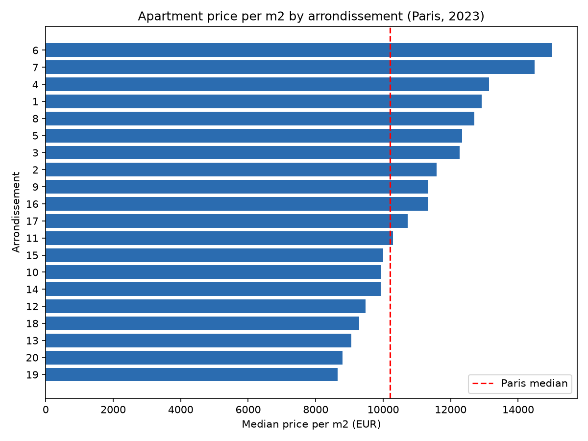
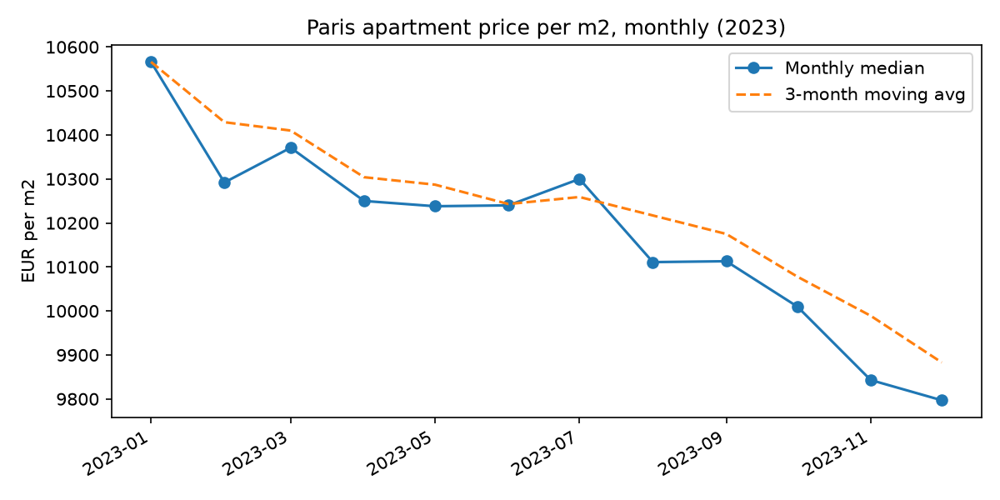

# Paris Real Estate Prices with SQL (DVF 2023)

SQL-first analysis of **26,866 apartment sales in Paris in 2023**, using DuckDB.
The goal is to show that I can clean a messy real-world dataset in SQL and answer business questions with joins, CTEs and window functions.

## Questions I wanted to answer
1. Which arrondissements are the most expensive, and by how much compared to the Paris median?
2. How did the price per m2 move during 2023?
3. Does the price per m2 depend on the size of the flat?
4. Which sales look abnormal for their arrondissement?

## Data
- **DVF** (Demandes de Valeurs Foncieres), open data from data.gouv.fr, geolocated version, year 2023, department 75.
- Not stored in the repo (too big). `python src/download_data.py` downloads it.

## Method
1. **Cleaning in SQL** (`sql/01_clean_sales.sql`). In DVF one sale can appear on many rows and the total price is repeated on each row. If I used the raw file, I would count the same price several times. So I keep only sales with exactly one apartment and no other built lot, then remove surfaces < 9 m2 or > 300 m2 and prices per m2 outside 2,000-30,000 EUR (typing errors, non-market sales).
2. **Price by arrondissement** (`02`): median, quartiles, `RANK()` and gap vs Paris median.
3. **Monthly trend** (`03`): `LAG` for the monthly change and a 3-month moving average with a window frame.
4. **Size buckets** (`04`): `CASE WHEN` buckets and medians.
5. **Outliers** (`05`): z-score by arrondissement with `PARTITION BY`.

I use the **median** and not the mean because a few very expensive flats pull the mean up.

## Main results
| | |
|---|---|
| Most expensive | 6th (~14,990 EUR/m2) and 7th (~14,480 EUR/m2), about +47% and +42% vs the Paris median |
| Cheapest | 19th (~8,650 EUR/m2) and 20th (~8,790 EUR/m2), about -15% and -14% |
| Trend in 2023 | median price per m2 goes from ~10,570 EUR in January to ~9,800 EUR in December (about -7%) |
| Size effect | flat between 20 and 70 m2 (~10,000 EUR/m2), higher for 100+ m2 (~12,100 EUR/m2) |




### Something I did not expect
I thought small flats would be more expensive per m2. In this data it is not true: the price per m2 is almost flat up to 70 m2, and large flats (100 m2+) are the most expensive. A possible explanation is that large flats are concentrated in the richest arrondissements (6th, 7th, 8th, 16th), so size and location are mixed. A regression with both variables would be the next step.

## Limitations
- Only one year, so the "trend" is a decline over 12 months, not a long-term view.
- DVF has no information on floor, view, renovation or elevator, which matter a lot for prices.
- August has few sales (1,240) because of holidays, so the monthly median is less stable.
- Prices are the declared sale prices, not the asking prices.

## How to run
```bash
pip install -r requirements.txt
python src/download_data.py
python src/run_analysis.py
```
Results are saved in `reports/` (csv tables and figures). You can also open the `.sql` files in DuckDB directly.

## Skills shown
SQL (CTE, window functions, `PARTITION BY`, `LAG`, quantiles), data cleaning, DuckDB, matplotlib, open data.
